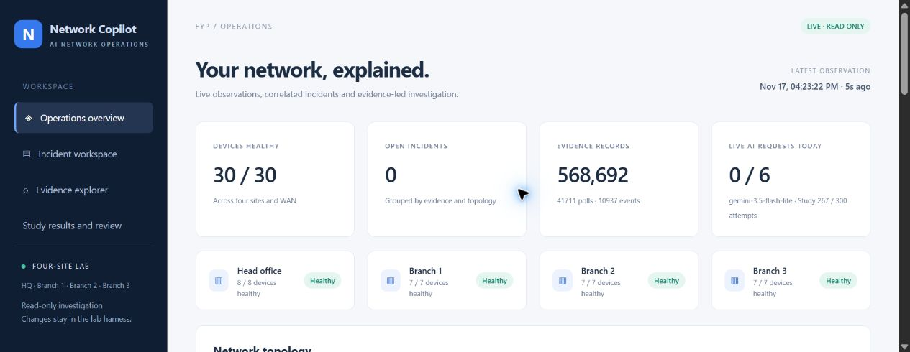
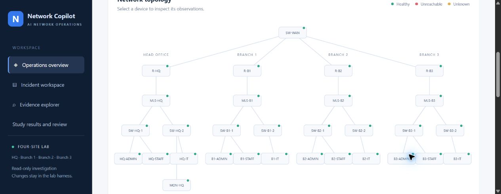
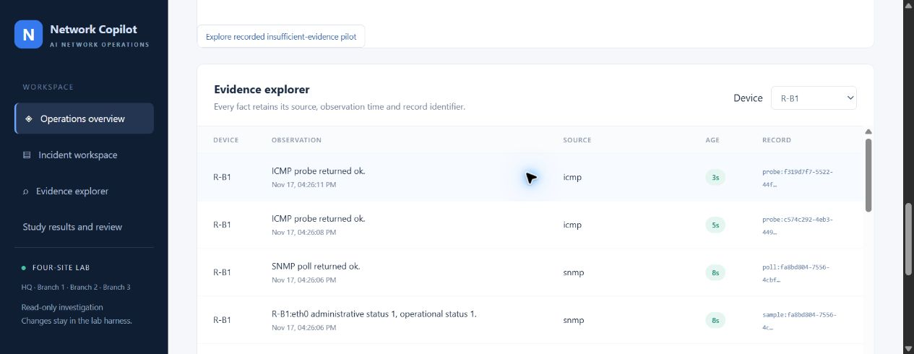
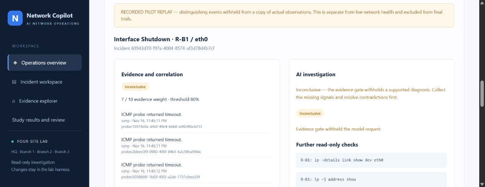
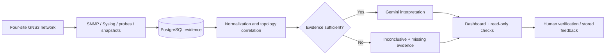

# AI Network Copilot

**Evidence-grounded network monitoring and troubleshooting in a four-site GNS3 lab.**


AI Network Copilot collects network observations, groups dependent alarms, checks whether the evidence is sufficient, and presents a tentative AI interpretation with fixed read-only verification steps. Engineers retain control over network changes.

This is a working FYP implementation with a controlled study: **30 nodes, 33 links, 70 final cases and 280 paired approach records**. It is an educational prototype, not a production NOC platform or an autonomous remediation agent.

## Live application

The screenshots below were captured from the actual running application after migrating it to this repository layout. They show the healthy lab; archived fault examples are available separately in the study viewer.



<details>
<summary>Network topology and evidence explorer screenshots</summary>







</details>

## What it does

- Collects SNMP interface state, counters, utilization and available device health; Syslog events; ICMP probes; and authorized read-only console snapshots.
- Stores identifiable, timestamped evidence in PostgreSQL.
- Correlates interface, OSPF and downstream reachability symptoms using topology and time.
- Requires weighted evidence coverage, every critical signal and no contradiction before supported AI investigation.
- Treats stale or unavailable observations as missing; can return **inconclusive**.
- Uses Gemini for tentative explanations and allowlisted read-only checks. Model output is never executed on a device.
- Stores confirm/reject/correct feedback without training or self-modifying learning.
- Provides archived replay, four comparison approaches, reproducible scoring and independent review materials.



## Quick start: inspect the completed study

This mode needs **Python 3.12**, but no GNS3 VM, Gemini key or cloud request:

```bash
git clone https://github.com/rayyan4t4/Ai-Network-Copilot.git
cd Ai-Network-Copilot
python app.py replay
```

Open **http://127.0.0.1:8766**. Select **Final study** to inspect the 280 recorded results. These are real archived lab observations and outputs, not a live network or new model responses. Stop the foreground viewer with `Ctrl+C` before starting the full services on the same port.

## Run the complete live lab

The tested live environment is Windows, GNS3 2.2.61, VMware Workstation, Python 3.12 and a Linux GNS3 VM with Docker. The reference laptop had 8 GB host RAM; the VM used 2 GB RAM and one vCPU. Database query indexes and independent snapshot collection reduce live export delays, but the laptop can still become unavailable during sleep, VM interruption or overload.

1. Create a Python environment and install host dependencies:

   ```powershell
   python -m venv .venv
   .\.venv\Scripts\python.exe -m pip install -r requirements.txt
   ```

2. Start GNS3 and its VM. Follow [setup and deployment](docs/setup.md) to build a fresh lab or adopt an existing matching project. Machine-specific deployment IDs, SSH trust, credentials and runtime state belong under ignored **`.local/`**.
3. Start all application services:

   ```powershell
   .\start.ps1
   ```

4. Open the interfaces:

   | Address | Purpose |
   | --- | --- |
   | http://127.0.0.1:8765 | Live health, topology, incidents, evidence and investigation |
   | http://127.0.0.1:8766 | Recorded study comparisons and feedback interface |

Allow roughly two minutes after a cold lab start. A healthy baseline is **30/30 healthy**, no stale-data warning and no active incidents. Expected ADMIN/STAFF policy blocks are part of the healthy configuration.

Automatic AI requests are paused by default. New model calls require your own private key and explicit normalized-summary sharing consent; see [Gemini setup](docs/setup.md#gemini-and-data-sharing). Recorded results make no new calls.

## Verify it

```powershell
.\.venv\Scripts\python.exe app.py test
.\.venv\Scripts\python.exe app.py verify
.\.venv\Scripts\python.exe app.py status
.\.venv\Scripts\python.exe app.py verify --live
```

| Check | What it establishes |
| --- | --- |
| `test` | 91 unit, integration, migration and startup-safety tests; no real cloud calls or device faults |
| `verify` | Published source lock, 490 unchanged final-case files and objective scores recomputed from all 280 records |
| `status` | Current live observation age, 30-node health and bridge availability |
| `verify --live` | Offline checks plus 243 network checks, 11 telemetry checks and a two-minute API freshness observation |

Saved release verification is under [docs/verification](docs/verification). Browser inspection is separate from API checks. The live overview, topology, device filtering and raw evidence inspection were checked in Chrome. The separate study-viewer origin remained blocked by a saved browser permission during release verification, although its service/API was tested. Incident-to-browser-display latency is **not established**.

To stop the local application services:

```powershell
.\stop.ps1
```

This leaves the network, PostgreSQL and collector running. Stop the GNS3 nodes and shut down the VM separately when ending the lab session.

## Repository layout

```text
Ai-Network-Copilot/
├── app.py                  # Replay, tests, status and verification CLI
├── start.ps1 / stop.ps1     # Identity-checked Windows service management
├── copilot/                # Dashboard, evidence engine, provider and storage
├── live/                   # Live model adapter and independent snapshot worker
├── collector/              # SNMP/Syslog/probes, PostgreSQL schema and migrations
├── evaluation/             # Study engine, evidence matrix, protocol and scoring
├── scripts/                # Lab build, deployment, verification and research tools
├── lab/                    # Topology, addressing, node scripts and Dockerfiles
├── research/               # Actual pilot/final records, controls, results and provenance
├── tests/                  # Startup safety and repository-migration tests
├── docs/                   # Setup, architecture, study, demo, review and screenshots
├── .github/workflows/      # Offline CI tests and research integrity check
└── .local/                 # Ignored machine configuration, secrets and runtime data
```

Files are organized by responsibility rather than implementation week. Historical version labels inside original study metadata are preserved for provenance. The original pre-trial source lock and the reorganized release lock have different purposes; see [release provenance](docs/provenance.md).

## Recorded evaluation

The study used **50 diagnosable faults**, **10 healthy windows** and **10 insufficient-evidence cases**. Each approach processed the same recorded windows. Pilots were separate. The five fault classes were interface shutdown, OSPF loss, ACL blocking, sustained utilization and unreachability.

| Approach | Exact root / 50 faults | Correct abstention / 10 insufficient cases | Pipeline detection F1 | Errors / 70 |
| --- | ---: | ---: | ---: | ---: |
| Direct alerts (B1) | 33 | 0 | 1.000 | 0 |
| Short-description AI (B2) | 1 | 9 | 0.039 | 1 |
| Structured AI without gate | 41 | 6 | 0.916 | 8 |
| Full system | 39 | 8 | 0.904 | 11 |

The full system achieved **78% exact-root accuracy** and **80% correct abstention** in these denominators. The no-gate variant had higher fault accuracy in this run. The results therefore **do not demonstrate an accuracy gain from gating**. Errors and abstentions remain in the fault denominator. Detection scores include the declared conservative treatment of failed outputs; they are not pure raw-correlator scores.

Sources: [results.json](research/results.json), [results.csv](research/results.csv), [protocol](evaluation/methods.md) and [interpretation boundaries](evaluation/clarifications.md). Timing covers recorded-window processing and API attempts with declared exclusions. The hosted-model study used 267 attempts including pilots and retries; the resource-only allowance amendment is retained.

## Documentation

- [Setup, images, credentials and troubleshooting](docs/setup.md)
- [Architecture and editable topology diagrams](docs/architecture.md)
- [GNS3 wiring template](lab/topology/network.gns3) and [port map](lab/topology/Port%20Map.md)
- [Technical report](docs/technical-report.md)
- [Demo and viva guide](docs/demo.md)
- [Reproducibility](docs/reproducibility.md) and [release provenance](docs/provenance.md)
- [Independent review plan](docs/human-review.md) and [review instructions](docs/review/Review%20instructions.md)

The `.gns3` template contains wiring and image references, not private volumes, credentials or a populated database. Use the deployment scripts to provision a functioning fresh lab. Private VM/database backups and appliance archives are deliberately not published.

## Limitations and academic status

This prototype runs FRR, Open vSwitch and nftables containers, with the OVS userspace datapath. It does not reproduce every Cisco IOS feature, Rapid-PVST or sticky MAC behavior. Virtual utilization counters are not a physical-throughput measurement, and ICMP suppression does not prove device power loss.

Two real independent reviewers must still assess unsupported claims and recommendation quality. Their ratings, agreement and academic approval are not fabricated or claimed complete. Team members must verify the work and university requirements before submission. Development and documentation used Codex and AI assistance.

The live lab uses SNMPv2c and local laboratory credentials; production security, deployment and broader validation are outside the evaluated scope. No open-source license has been selected for this repository; publication alone does not grant an additional software license. Third-party dependencies retain their own licenses.
