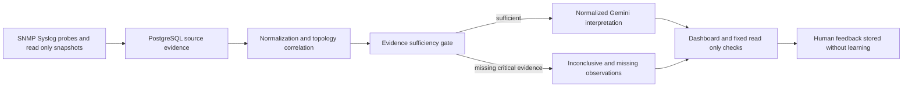
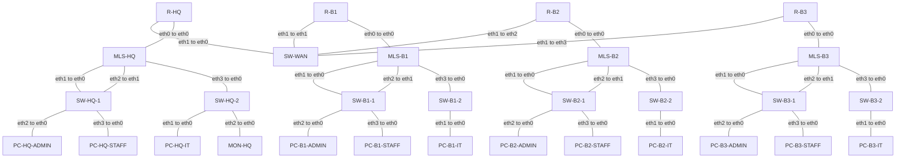

# Architecture and topology diagrams

The diagrams describe the implemented lab. They are editable Mermaid source. Full topology ports and purposes come from the saved deployment manifest.

## Investigation pipeline

The trusted injection harness is outside the diagnostic application. Ground truth is stored separately and does not enter correlation or model requests.

## Full GNS3 topology

The paired uplinks form LACP. The WAN is a shared switched segment. Each site uses ADMIN, STAFF and IT VLANs, with expected policy blocks documented in the report.